<p align="center">
  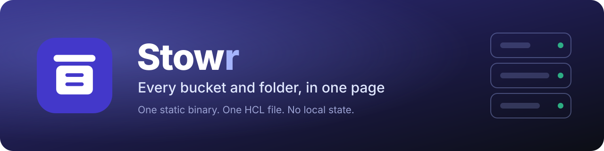
</p>

<p align="center">
  <a href="https://github.com/ProcurAuth/stowr/actions/workflows/ci.yaml"></a>
  <a href="https://github.com/ProcurAuth/stowr/releases/latest"></a>
  <a href="#licence"></a>
  <a href="https://procurauth.github.io/procurauth/implementations.html"></a>
  
  
</p>

<p align="center">
  <a href="https://procurauth.github.io/stowr/"><b>Website</b></a> ·
  <a href="#documentation">Docs</a> ·
  <a href="https://procurauth.github.io/stowr/access.html">Access</a> ·
  <a href="https://procurauth.github.io/stowr/configuration.html">Configuration</a> ·
  <a href="SECURITY.md">Security</a> ·
  <a href="https://github.com/ProcurAuth/stowr/releases/latest">Downloads</a>
</p>

# Stowr

Stowr is a web application that browses S3-compatible storage, Google Cloud Storage and folders of the server. It shows
the objects, previews them, and works on them: upload, download, copy, move, rename, delete, tags, versions and more.

It is for operators and teams who run their own storage. They need one page for many buckets, on a host with little
memory, and for objects of hundreds of gigabytes. **Stowr reads only the bytes that it shows, and it keeps no database
and no cache on disk.**

<p align="center">
  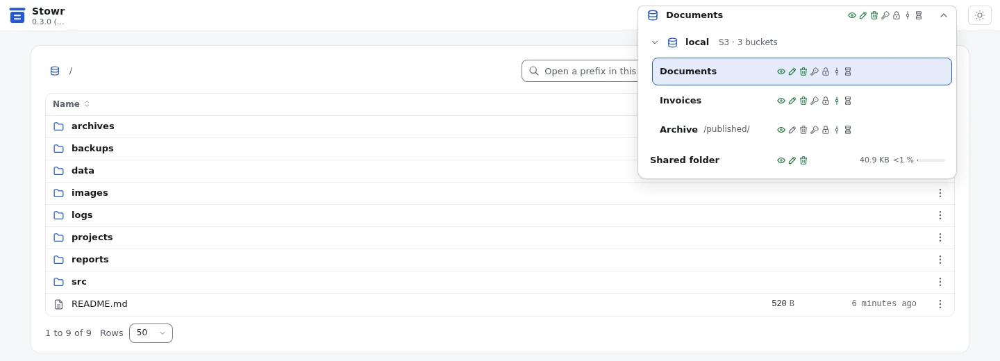
</p>

## How it works

Stowr is one static binary. It has the interface inside. The browser talks to the HTTP server of Stowr. In the mode
`authzen`, an edge signs an identity token, and Stowr asks a decision point (PDP) before each operation.

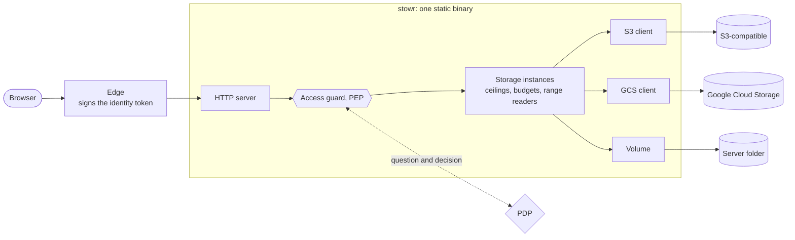

<p align="center">
  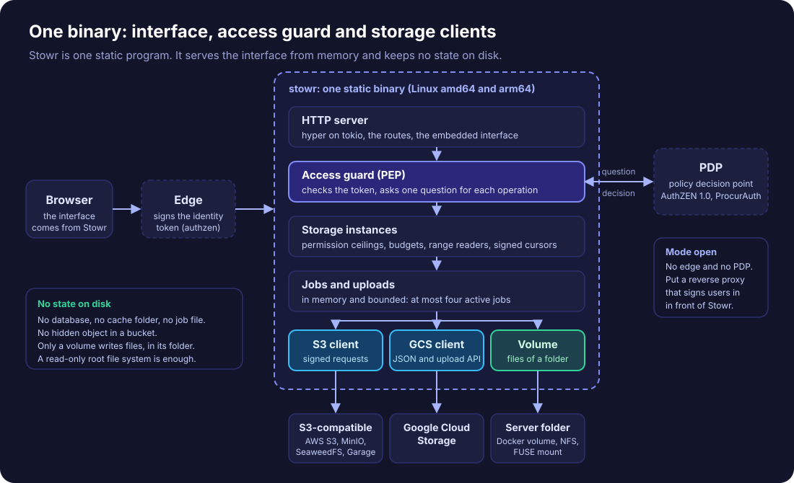
</p>

Each request follows the same rule: the decision comes before the first byte. A listing reads one page of keys. A large
object is read with exact byte ranges. An upload goes in chunks, with a token that lets a client resume it.

<p align="center">
  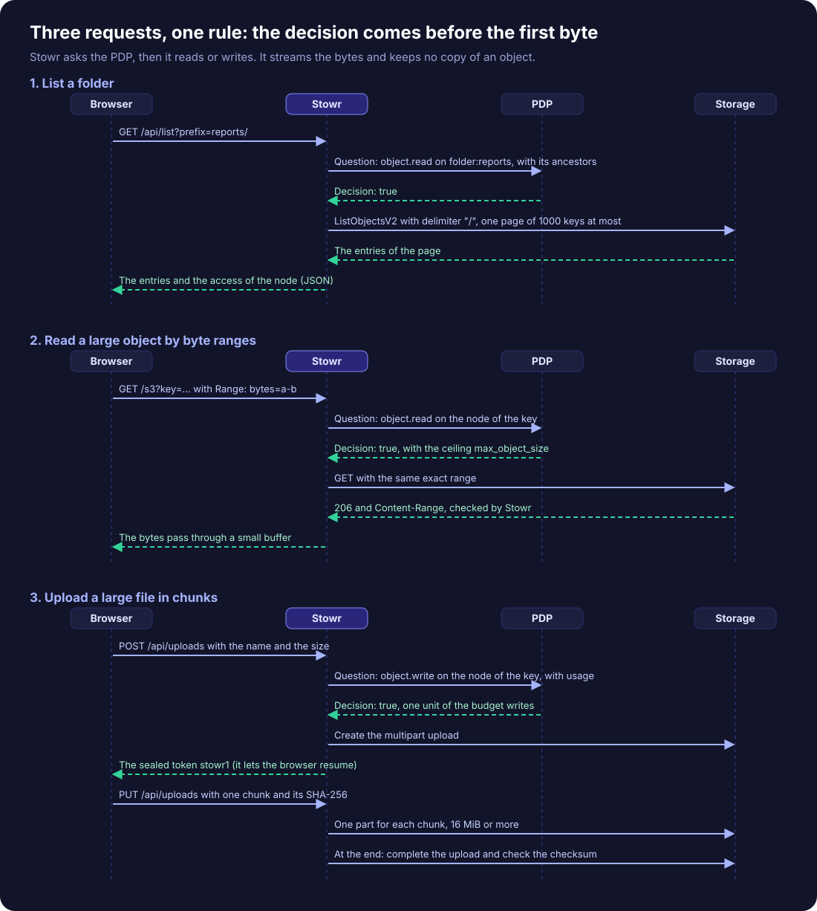
</p>

| Area | What Stowr does |
| --- | --- |
| Storage | AWS S3, MinIO, SeaweedFS and Garage through the S3 API. Google Cloud Storage. Folders of the server (Docker volumes, NFS, FUSE) as volumes. |
| Browsing | Dense tables, folders, search, sort, tags, version counts, and the settings of the columns. |
| Previews | Text, code, Markdown, JSON, CSV, Parquet, SQLite, Excel, Word, PDF, images, audio, video, archives, certificates and email. Each preview reads bounded byte ranges. |
| Large objects | Exact byte-range readers. An integrity check that hashes the stream. An inspection of the structure. Insights on a folder. |
| Operations | Resumable upload with SHA-256 checksums. Copy in parts for large objects. Archive download and extraction. Edit of metadata and tags. |
| Versions | The versions of an object, restore, permanent delete, and the comparison of two versions in the browser. |
| Bucket functions | Lifecycle rules, Object Lock, SSE-S3 encryption, incomplete multipart uploads, and the usage and quota of a bucket. |
| Access | The mode `authzen` checks an identity token and asks a PDP. The mode `open` needs a proxy that signs users in. |
| Configuration | One HCL file. A closed schema. A mistake stops the start. `print-config` shows each value and its source. |
| Runtime | No database, no cache folder. Only a write to a volume uses a temporary file, in the folder of the target. A read-only root file system is enough. No request to another origin. |

## Example

Stowr is a PEP of [ProcurAuth](https://github.com/ProcurAuth/procurauth). The resource tree is service, bucket, folder and
subfolder. The node of a key is its deepest folder. A grant on a node covers each node below it.

<p align="center">
  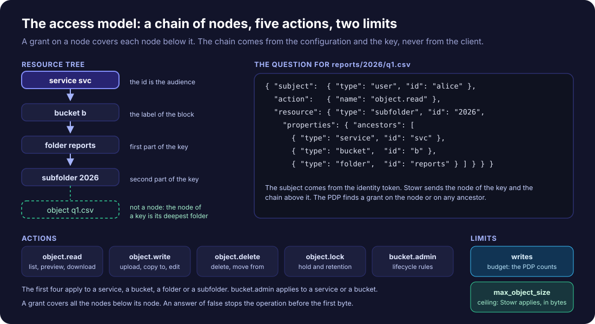
</p>

A worked example. This `access` block makes Stowr check the tokens of an edge and ask a PDP:

```hcl
access {
  mode = "authzen"

  identity {
    issuer           = "https://edge.example.com"
    audience         = "stowr"
    public_keys_file = "/etc/stowr/edge-jwks.json"
  }

  pdp {
    url        = "https://pdp.example.com:4182"
    token_file = "/etc/stowr/pdp-token"
  }
}
```

Alice opens `reports/2026/q1.csv` in the bucket `finance`. Stowr checks her token, then it asks the PDP:

```json
{ "subject":  { "type": "user", "id": "alice" },
  "action":   { "name": "object.read" },
  "resource": { "type": "subfolder", "id": "2026",
                "properties": { "ancestors": [ { "type": "service", "id": "stowr" },
                                               { "type": "bucket",  "id": "finance" },
                                               { "type": "folder",  "id": "reports" } ] } } }
```

The PDP answers `{"decision": true, "context": {"limits": {"max_object_size": 104857600}}}`. Stowr reads the object and
refuses a size over 100 MiB. An answer of `false` gives `403`. A spent budget gives `429` with `Retry-After`. A PDP that does not answer gives `503`, never a grant. [docs/ACCESS.md](docs/ACCESS.md) has the rules.

## See it

| | |
| --- | --- |
| 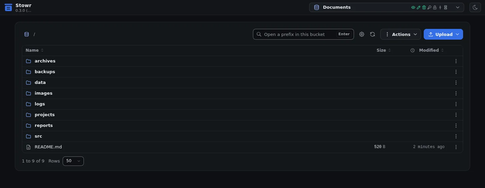 | 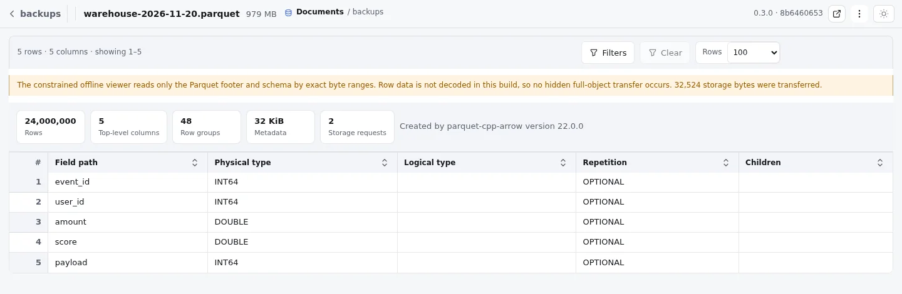 |
| The dark theme. The interface has a light theme and a dark theme. | A large Parquet file. Stowr reads the footer only: 2 storage requests. |
| 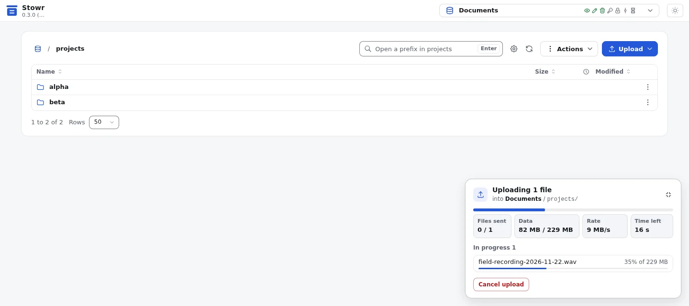 | 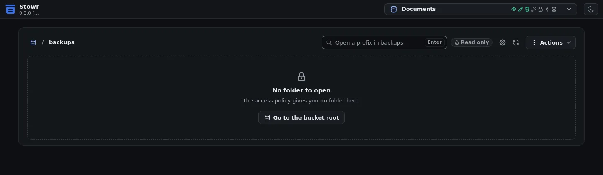 |
| An upload of 229 MB, with the rate and the time left. | A folder that the PDP refuses. |

The [website](https://procurauth.github.io/stowr/) has more pictures. They show previews of images, JSON, CSV and archives, the inspection of a large object, Insights, and the information page of a bucket.

## Quick start

This test takes five minutes. It runs a local S3-compatible service in Docker, bound to `127.0.0.1`. It pushes no image.

```sh
docker run -d --rm --name stowr-demo-s3 -p 127.0.0.1:8333:8333 chrislusf/seaweedfs:4.41 server -s3 -dir=/data \
  -master.volumeSizeLimitMB=64 -volume.max=30 -volume.minFreeSpace=1GiB
sleep 10
curl -s -X PUT http://127.0.0.1:8333/demo
printf '# Hello\n\nThis file is in the bucket demo.\n' | curl -s --retry 5 --retry-delay 2 --retry-all-errors \
  -X PUT -H 'Content-Type: text/markdown' --data-binary @- http://127.0.0.1:8333/demo/notes/hello.md
```

Download Stowr, check the archive, and write the configuration. For arm64, use the archive `stowr_0.3.0_linux_arm64.tar.gz`.

```sh
curl -fsSLO https://github.com/ProcurAuth/stowr/releases/download/v0.3.0/stowr_0.3.0_linux_amd64.tar.gz
curl -fsSLO https://github.com/ProcurAuth/stowr/releases/download/v0.3.0/checksums.txt
sha256sum --check --ignore-missing checksums.txt
tar -xzf stowr_0.3.0_linux_amd64.tar.gz
cat > config.hcl <<'EOF'
access { mode = "open" }
server { listen = "127.0.0.1:8080" }
auth "local" {
  provider = "s3"
  mode     = "anonymous"
  endpoint = "http://127.0.0.1:8333"
  region   = "us-east-1"
}
bucket "demo" {
  name        = "Demo"
  auth        = "local"
  bucket      = "demo"
  permissions = ["read", "write", "delete"]
}
EOF
./stowr print-config -c config.hcl
./stowr -c config.hcl
```

Open `http://127.0.0.1:8080/`. Press Ctrl+C to stop Stowr, then run `docker stop stowr-demo-s3`.
[docs/GETTING-STARTED.md](docs/GETTING-STARTED.md) explains each step. To build the binary from the source, run
`scripts/static.sh --copy .` (Docker only).

## The ProcurAuth family

Stowr is a program of the [ProcurAuth](https://github.com/ProcurAuth) organisation. The organisation holds the open specification and the programs that follow it. The [implementations page](https://procurauth.github.io/procurauth/implementations.html) lists them, with the results of the conformance runs.

<p align="center">
  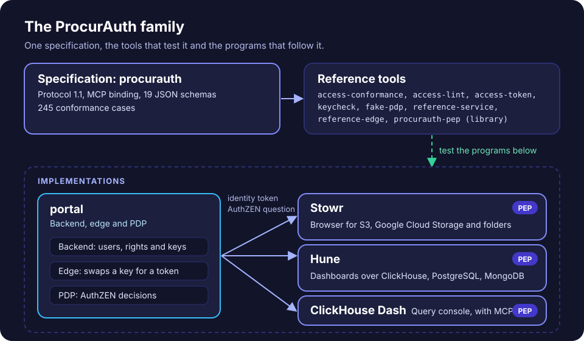
</p>

| Part | Role | Repository | Site |
| --- | --- | --- | --- |
| **procurauth** | The specification and the reference tools | [ProcurAuth/procurauth](https://github.com/ProcurAuth/procurauth) | [procurauth.github.io/procurauth](https://procurauth.github.io/procurauth/) |
| **portal** | Backend, edge and PDP | [ProcurAuth/portal](https://github.com/ProcurAuth/portal) | [procurauth.github.io/portal](https://procurauth.github.io/portal/) |
| **Stowr** | PEP: a browser for S3, Google Cloud Storage and folders | [ProcurAuth/stowr](https://github.com/ProcurAuth/stowr) | [procurauth.github.io/stowr](https://procurauth.github.io/stowr/) |
| **Hune** | PEP: dashboards over ClickHouse, PostgreSQL and MongoDB | [ProcurAuth/hune](https://github.com/ProcurAuth/hune) | No public site yet |
| **ClickHouse Dash** | PEP and MCP server: a query console for ClickHouse | Outside this organisation | [Implementations page](https://procurauth.github.io/procurauth/implementations.html#programs) |

To add a program to this list, open an issue in the [specification repository](https://github.com/ProcurAuth/procurauth/issues).

## Documentation

| Page | Content |
| --- | --- |
| [Getting started](docs/GETTING-STARTED.md) | The five-minute test, step by step. |
| [Configuration](docs/CONFIGURATION.md) and [reference](docs/configuration-reference.md) | The blocks, the keys, the defaults. The reference comes from the code. |
| [Architecture](docs/ARCHITECTURE.md) | The runtime, the uploads, the jobs, versions, lifecycle, lock, encryption and volumes. |
| [Access](docs/ACCESS.md) and [conformance](docs/CONFORMANCE.md) | The identity token, the resource tree, the routes, the errors, and the test of ProcurAuth. |
| [Security model](docs/SECURITY-MODEL.md) | What Stowr protects, and how. |
| [Operations](docs/OPERATIONS.md) | Service, network, logs, limits, upgrade and troubleshooting. |
| [Previews](docs/PREVIEWS.md) | The formats and the rules of the previews. |
| [Development](docs/DEVELOPMENT.md) | The scripts, the tests, the dependencies and the release. |
| [Changelog](CHANGELOG.md) | The changes of each version. |

The same pages are on the [website](https://procurauth.github.io/stowr/). The Markdown files are the source.

## Build and test

Use Docker. Do not install Rust on your machine.

```sh
scripts/cargo.sh fmt --all -- --check
scripts/cargo.sh clippy --all-targets --locked -- -D warnings
scripts/cargo.sh test --locked
scripts/check-invariants.sh
python3 -I scripts/check-docs.py
```

## Security

Do not open a public issue for a vulnerability. Use the [private report](https://github.com/ProcurAuth/stowr/security/advisories/new).
[SECURITY.md](SECURITY.md) tells the supported versions and the response times. The [security model](docs/SECURITY-MODEL.md) tells what Stowr protects.

## Contribute

Read [CONTRIBUTING.md](CONTRIBUTING.md). Open an issue with one of the [forms](https://github.com/ProcurAuth/stowr/issues/new/choose)
to ask a question or to report a defect. This project follows the [code of conduct](CODE_OF_CONDUCT.md).

## Licence

Stowr is under the licence `MIT OR Apache-2.0`. You can use it under the terms of either licence. The files
[`LICENSE-MIT`](LICENSE-MIT) and [`LICENSE-APACHE`](LICENSE-APACHE) hold the two texts. The third-party files that Stowr
embeds keep their own licences: see [THIRD-PARTY-NOTICES.md](THIRD-PARTY-NOTICES.md).
